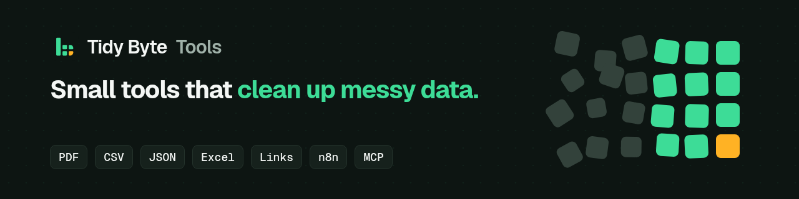

# Tidy Byte Tools

Small tools that clean up messy data. Each one does one job and does it well.

The official website, with prices and links, is [tidybytetools.github.io](https://tidybytetools.github.io).

## Free tools
- [json-shaper-lite](https://github.com/tidybytetools/json-shaper-lite) turns notes, CSV and Markdown tables into clean JSON.
- [pdf-table-pull-lite](https://github.com/tidybytetools/pdf-table-pull-lite) pulls tables out of text PDFs into CSV.
- [doc2md-lite](https://github.com/tidybytetools/doc2md-lite) turns text PDFs and web pages into clean Markdown for AI tools.
- [link-check-lite](https://github.com/tidybytetools/link-check-lite) checks a list of links and shows which ones are broken or redirect.
- [md-chunk-lite](https://github.com/tidybytetools/md-chunk-lite) splits long Markdown notes and docs into neat pieces, one per heading, so an AI can read them.

## Paid tools
These are on [Gumroad](https://tidybyte.gumroad.com).
- [doc2md](https://tidybyte.gumroad.com/l/frlkv) turns PDF, Word and HTML files into clean Markdown, plus chunks ready for AI search.
- [pdf-table-pull](https://tidybyte.gumroad.com/l/hkxqxh) adds Excel output, scanned PDFs and tables that run across pages.
- [lead-sheet-fixer](https://tidybyte.gumroad.com/l/iaiacv) cleans the lead list you already have: phones fixed, bad emails flagged, duplicates merged.
- [sheet-scrub](https://tidybyte.gumroad.com/l/cknndc) cleans messy Excel and CSV files in one command, fixing duplicates, dates, phone numbers and emails.
- [json-shaper](https://tidybyte.gumroad.com/l/cznmeo) also parses app logs and US addresses.
- [gif-forge](https://tidybyte.gumroad.com/l/vjbsqs) turns videos into small, sharp GIFs in batches and removes image backgrounds, all offline.
- [server-pulse](https://tidybyte.gumroad.com/l/cjatbj) sends Discord alerts when a site or game server goes down, plus Stripe and PayPal donation alerts.
- [Data Cleanup Bundle](https://tidybyte.gumroad.com/l/qnlxiy) gets you pdf-table-pull, sheet-scrub and json-shaper together and saves you $7.

## Where else to find us
- PyPI: every free tool installs with one line, like `pip install pdf-table-pull-lite` ([see it on PyPI](https://pypi.org/project/pdf-table-pull-lite/)).
- [MCP Registry](https://registry.modelcontextprotocol.io/v0/servers?search=io.github.tidybytetools): the free tools also work as MCP servers for AI agents.
- [Glama](https://glama.ai/mcp/servers/tidybytetools/link-check-lite): MCP server listing.

## Help
Found a bug? Open an issue on the tool's repo and I'll take a look.
Bought a paid tool? Reply to your Gumroad receipt email. Every paid tool has a 30-day refund.
